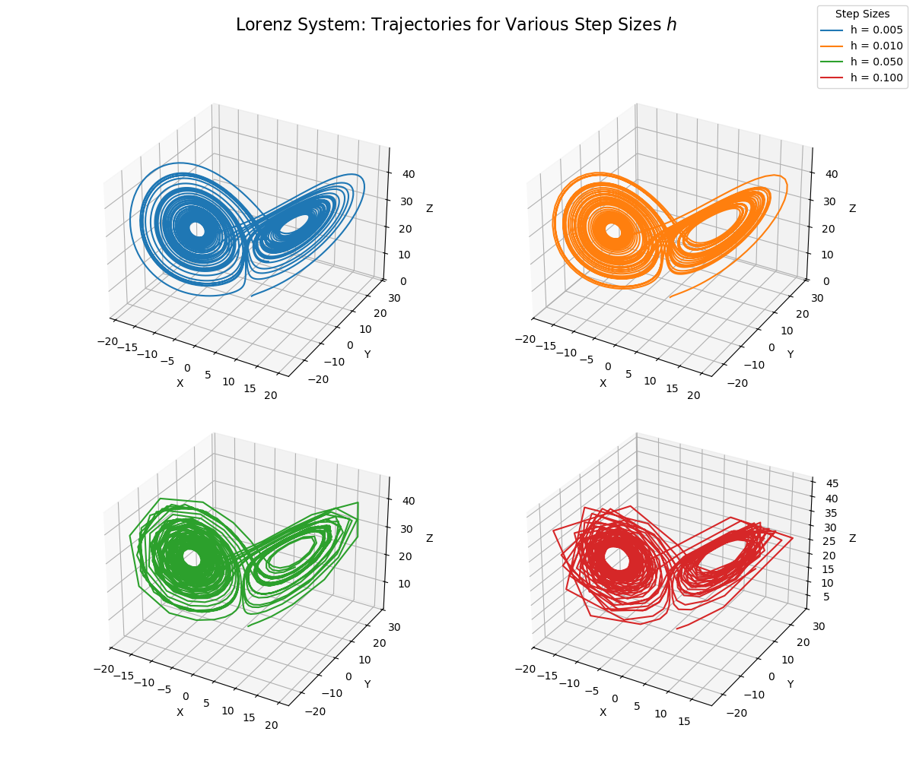
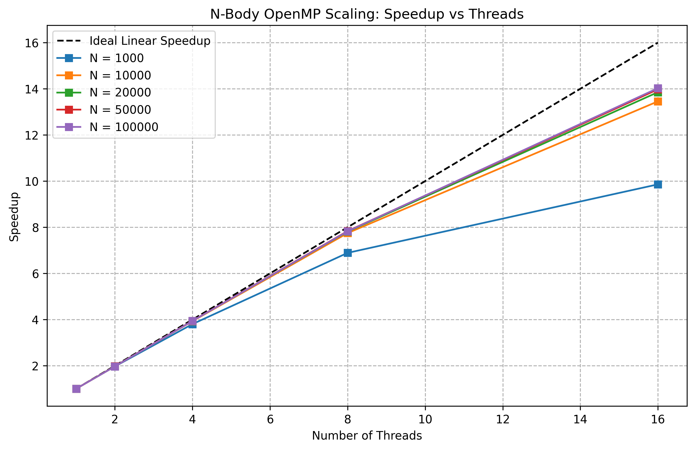
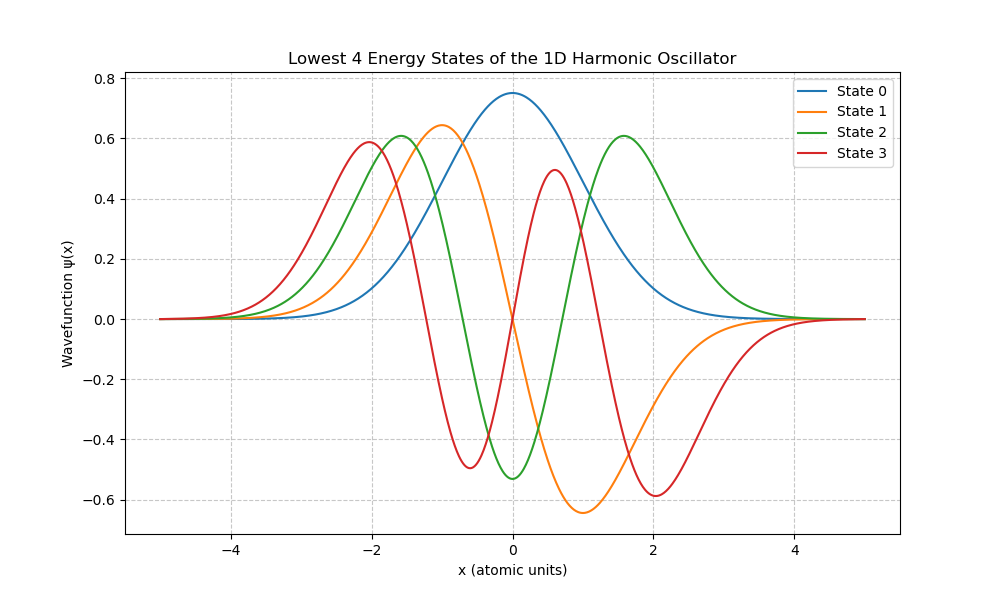

# Scientific High Performance Computing

This repository contains the source code for assignments and projects completed in my Master's. The project focuses on implementing efficient numerical methods and physical simulations in C and Python.

## Contents

- **Assignment_1**: Initial simulations and bouncing ball models, exploring numerical integration and data visualization.
- **Assignment_2**: Advanced simulations including leapfrog integration, convergence testing, and error analysis for physical systems.
- **Assignment_3**: Numerical methods for eigenvalue problems, Lorenz systems, and Schrödinger equations.
- **Assignment_4**: Fourier analysis, Discrete Fourier Transforms, quantum wavepacket evolution, and Monte Carlo integration.
- **Project_1**: Distributed Monte Carlo integration using MPI, including performance comparison.
- **Project_2**: N-body simulation with serial and OpenMP parallel implementations and scaling analysis.

## Simulation Highlights

### Lorenz System Trajectories (`Assignment_3`)
3D phase-space trajectories of the chaotic Lorenz attractor integrated across decreasing step sizes ($h = 0.005$ to $0.100$), illustrating numerical resolution and sensitivity to discretization.

### OpenMP N-Body Parallel Scaling (`Project_2`)
Multi-threaded OpenMP speedup up to 16 threads across particle counts from $N = 1{,}000$ to $100{,}000$, achieving ~14× speedup on large workloads versus parallel overhead limits at small $N$.

### 1D Quantum Harmonic Oscillator Eigenstates (`Assignment_3`)
Lowest four bound-state wavefunctions $\psi(x)$ obtained via finite-difference discretization of the time-independent Schrödinger equation.

## Key Technologies

- **Language**: C (Simulation Logic), Python (Data Analysis and Plotting)
- **Tools**: GCC, MPI, OpenMP, Gnuplot, Matplotlib
- **Concepts**: Numerical Stability, Convergence Analysis, High-Performance Computing Primitives
